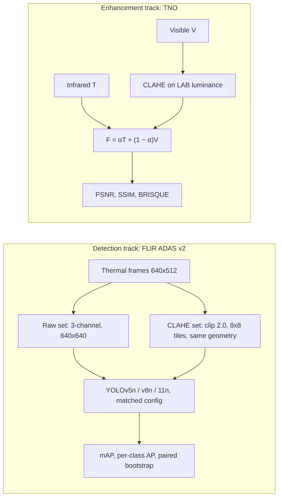
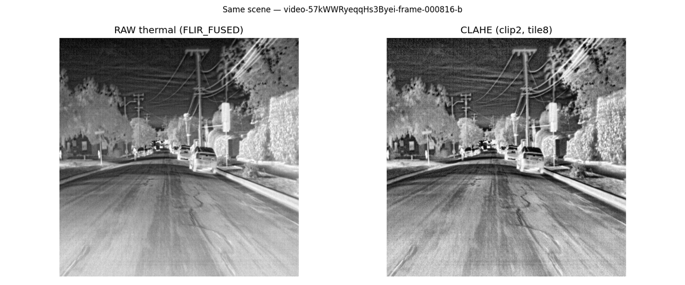
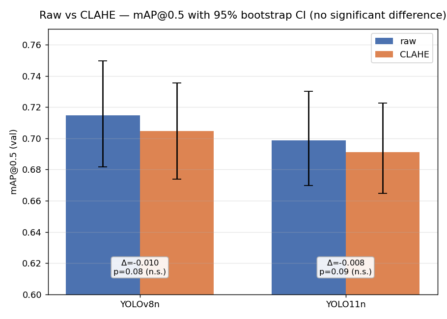
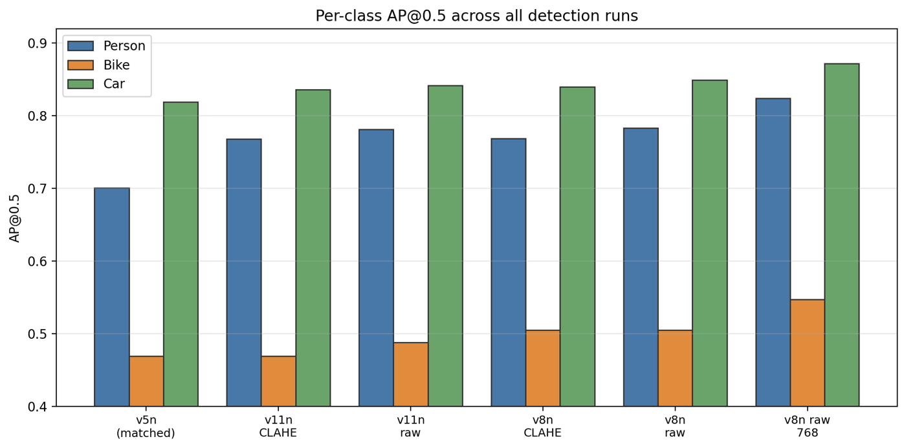
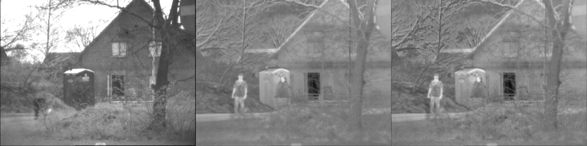
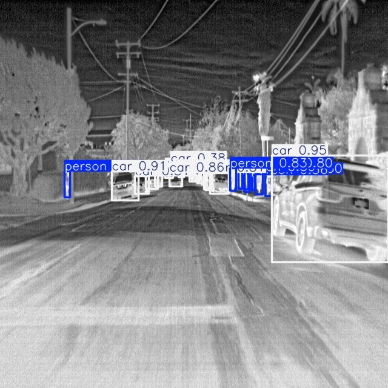

# Training-Free Enhancement for Thermal Night Vision

**A controlled study of CLAHE and infrared–visible fusion with lightweight object detection**

B.Sc. thesis, Department of Computer Science & Engineering, Rajshahi University of Engineering & Technology (RUET), 2026
Author: Nafees Ahamed · Supervisor: Farjana Parvin, Assistant Professor, CSE, RUET

---

## Summary

Visible-light cameras fail at night, and most published fixes (deep enhancement networks, multi-branch RGB–thermal fusion detectors) need heavy GPUs. This thesis asks how far a simple, training-free approach can go on a single consumer GPU (NVIDIA GTX 1070, 8 GB).

It runs two controlled experiments:

1. **Detection:** three nano-scale detectors (YOLOv5n, YOLOv8n, YOLO11n) trained on FLIR ADAS v2 thermal images, with and without CLAHE contrast enhancement, under identical settings. The CLAHE effect is tested for statistical significance with a paired bootstrap.
2. **Enhancement:** training-free weighted-sum fusion of infrared and visible images on 48 TNO pairs, with and without CLAHE, scored with PSNR, SSIM and BRISQUE.

## Key findings

- **YOLOv8n reaches 0.713 mAP@0.5 at 49 FPS** on a GTX 1070.
- **CLAHE does not help detection.** Across two architectures the difference is −0.008 to −0.010 mAP@0.5, not statistically significant (p ≈ 0.08).
- **Higher training resolution does help.** YOLOv8n at 768 × 768 reaches **0.749 mAP@0.5** (+0.028, p = 0.001), the only significant gain in the study. This matches the official FLIR three-class baseline (about 0.74) with a 3.2M-parameter model.
- **Test-time augmentation and tiled inference (SAHI) make detection worse** on these images, because FLIR frames are already at the network's input resolution.
- **CLAHE does help images people look at.** CLAHE before fusion improves SSIM by +0.07–0.09 and BRISQUE by 3.7–4.8 points at every fusion weight. At α = 0.6 the fused image adds thermal detail with no measured loss in perceptual quality.
- **Dataset issue documented:** the RGB annotations in FLIR ADAS v2 do not line up with the paired thermal frames, so supervised RGB–thermal fusion detection on this dataset needs re-annotation.

**Conclusion:** CLAHE matters for human-facing enhancement, but a modern lightweight detector does not need it.

## Pipeline




*The same FLIR thermal frame, raw (left) and with CLAHE (right).*

## Results

### Detection (FLIR ADAS v2 thermal validation set, 1,144 images)

All runs: 60 epochs, batch 16, 640 px, COCO-pretrained, SGD with cosine schedule. Per-class values are AP@0.5.

| Model | Input | Params | mAP@0.5 | mAP@0.5:0.95 | Person | Bike | Car |
|---|---|---|---|---|---|---|---|
| YOLOv8n | raw | 3.2M | **0.713** | 0.454 | 0.783 | 0.505 | 0.849 |
| YOLOv8n | CLAHE | 3.2M | 0.708 | 0.451 | 0.769 | 0.505 | 0.840 |
| YOLO11n | raw | 2.6M | 0.703 | 0.446 | 0.781 | 0.488 | 0.842 |
| YOLO11n | CLAHE | 2.6M | 0.695 | 0.439 | 0.768 | 0.469 | 0.836 |
| YOLOv5n | raw | 1.9M | 0.666 | 0.391 | 0.701 | 0.469 | 0.819 |
| YOLOv8n | raw, 768 px, 100 epochs | 3.2M | **0.749** | 0.489 | 0.824 | 0.547 | 0.872 |

### Is the CLAHE effect real? (paired bootstrap, 2,000 resamples)

| Comparison | Δ mAP@0.5 | 95% CI | p | Significant |
|---|---|---|---|---|
| YOLOv8n: CLAHE vs raw | −0.010 | [−0.024, +0.002] | 0.084 | No |
| YOLO11n: CLAHE vs raw | −0.008 | [−0.017, +0.001] | 0.085 | No |
| YOLOv8n: 768 vs 640 px | +0.028 | [+0.014, +0.041] | 0.001 | Yes |




*Car > person > bike in every run; the bike class is rare (170 of 11,768 validation instances).*

### Enhancement (TNO, 48 infrared–visible pairs)

PSNR and SSIM are measured against the visible image; BRISQUE is no-reference (lower is better).

| Method | PSNR (dB) | SSIM | BRISQUE ↓ |
|---|---|---|---|
| Visible only | – | – | 21.76 |
| Fused, α = 0.6 | 14.53 | 0.669 | 24.56 |
| **CLAHE + fused, α = 0.6** | 14.16 | **0.753** | **20.88** |
| Fused, α = 0.7 | 13.19 | 0.586 | 26.62 |
| CLAHE + fused, α = 0.7 | 12.98 | 0.676 | 21.98 |
| Fused, α = 0.8 | 12.03 | 0.503 | 29.27 |
| CLAHE + fused, α = 0.8 | 11.92 | 0.577 | 24.44 |


*Visible image, plain fusion, and CLAHE + fusion (α = 0.7). People that are faint in the visible image stand out after fusion.*

### Runtime (GTX 1070)

| Stage | Cost |
|---|---|
| CLAHE enhancement | < 10 ms per image (CPU) |
| Fusion including CLAHE | < 10 ms per pair (CPU) |
| YOLOv8n inference, 640 px | 20.3 ms per image (49 FPS), end to end |
| Training, 60 epochs | about 3.5 hours per run |



Full tables are in [`results/`](results/) as CSV files.

## Repository contents

| Path | What it does |
|---|---|
| `src/build_clahe_set.py` | Builds the CLAHE training set from FLIR thermal frames, keeping file names, split and labels identical to the raw set |
| `src/train_ultralytics.py` | Trains YOLOv8n or YOLO11n with the thesis reference configuration (`--hires` for the 768 px run) |
| `src/fusion_eval.py` | Fuses TNO infrared–visible pairs with and without CLAHE and scores PSNR, SSIM and BRISQUE |
| `src/bootstrap_significance.py` | Paired-bootstrap test of the mAP@0.5 difference between two models on the same images |
| `scripts/run_campaign.ps1` | Runs training jobs back to back on Windows and resumes from the last checkpoint after a crash or restart |
| `configs/` | Dataset configs for the raw and CLAHE sets |
| `results/` | The thesis result tables as CSV |

## About this code

The original experiment scripts were lost after the thesis was submitted. The code here is rebuilt from the listings printed in Appendix B of the thesis. Where those listings were shortened (the lookup of original FLIR frames, IoU matching, and the 101-point AP calculation used by the bootstrap), the missing parts were written fresh for this repository and are marked in the code.

All numbers in this README come from the original experiments reported in the thesis. The rebuilt code has been checked on small synthetic inputs; it has not been re-run on the full datasets.

## Reproducing

```bash
pip install -r requirements.txt

# 1. Build the CLAHE set from the raw set
python src/build_clahe_set.py --src "<FLIR_ADAS_v2>" --raw "<raw_set>" --dst "<clahe_set>"

# 2. Train (edit the paths in configs/ first)
python src/train_ultralytics.py --weights yolov8n.pt --data configs/flir.yaml --name v8n_raw
python src/train_ultralytics.py --weights yolov8n.pt --data configs/flir_clahe.yaml --name v8n_clahe

# 3. Save validation predictions for each model, then test the difference
yolo val model=runs/detect/v8n_raw/weights/best.pt data=configs/flir.yaml save_txt save_conf conf=0.001
python src/bootstrap_significance.py --labels <val_labels> --preds-a <raw_preds> --preds-b <clahe_preds>

# 4. Enhancement track: pairs.csv lists ir_path,vis_path for each TNO pair
python src/fusion_eval.py --pairs pairs.csv --out results/tno
```

**Datasets** (not included; download from the providers):
- FLIR ADAS v2 thermal dataset, Teledyne FLIR
- TNO Image Fusion Dataset, A. Toet, *Data in Brief*, 2017

## Environment

Training and GPU evaluation: Windows laptop, NVIDIA GTX 1070 (8 GB), conda environment with PyTorch, Ultralytics and the YOLOv5 repository. OpenCV for CLAHE, scikit-image for PSNR/SSIM, piq for BRISQUE, SAHI for tiled inference.

## Citation

```
N. Ahamed, "Training-Free Enhancement for Thermal Night Vision: A Controlled Study of
CLAHE and Infrared–Visible Fusion with Lightweight Object Detection," B.Sc. thesis,
Dept. of CSE, Rajshahi University of Engineering & Technology, Bangladesh, 2026.
```
